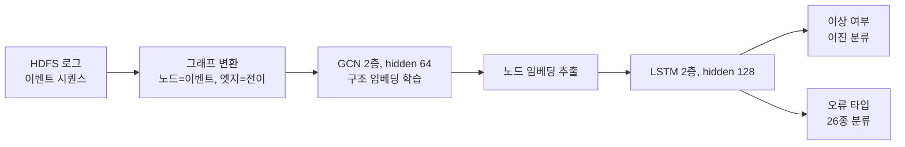

# GCN-LSTM 실시간 로그 이상탐지 및 자동 대응 시스템

HDFS 로그의 이벤트 시퀀스를 **그래프(구조) + 시계열** 두 관점으로 학습해 이상을 탐지하는 졸업프로젝트입니다. Flask 기반 탐지 API와 규칙 기반 대응, 대시보드는 시연용 프로토타입입니다. 발표 당시의 평가 방식에 문제가 있어 프로젝트가 끝난 뒤 다시 학습하고 평가했습니다. 두 결과를 모두 아래에 적었습니다.

- **기간**: 2024.09 ~ 2024.12 (인하대 정보통신종합설계, 3인 팀). 재평가는 프로젝트 종료 후
- **본인(김재민) 역할**: 3인 팀에서 모델 설계·실험·평가를 함께 하고, 시스템 설계 파트를 발표했습니다. 학과 결과 논문 공저자입니다. 데이터 전처리와 시스템 통합·자동 대응은 팀장 담당입니다.
- **스택**: PyTorch · PyTorch Geometric · Flask + Flask-SocketIO · pandas · Loghub HDFS_v1

## 문제 / 배경

대규모 분산 시스템은 초당 수천 건의 로그를 쏟아내고, 사람이 이걸 감시하는 방식은 늦고 담당자마다 결과가 다릅니다. 정상 로그가 압도적으로 많은 **불균형 데이터**(이상 약 2.9%)이고, 이상탐지에서 미탐(놓친 이상)은 장애·데이터 손실로 이어집니다.

## 접근 — 왜 GCN과 LSTM을 결합했나

순서는 정상인데 이벤트 조합이 비정상인 경우를 잡으려고 로그 블록을 그래프로 바꿨고, 그래프에서 얻은 임베딩을 순서대로 LSTM에 넣었습니다. 단독 모델 실험(레포의 노트북 2개)도 했지만 결합 모델과 같은 조건의 비교는 아니었습니다.

블록별 이벤트 시퀀스를 그래프로 변환(이벤트=노드, 연속 발생 전이=엣지, 노드 특징은 원-핫)한 뒤:



학습은 GCN을 먼저 학습해 임베딩을 뽑고 LSTM을 따로 학습하는 **2단계 방식**입니다. 두 모델을 한 번에 학습하면 약 20시간이 걸릴 것으로 예상해 나눴습니다(아래 한계 참고).

## 성능 (2024년 발표 당시)

| 지표 | GCN 단독 | LSTM 단독 | **GCN-LSTM** |
|---|---|---|---|
| Recall | 0.64 | 0.87 | **0.96** |
| Precision | 0.96 | 0.97 | 0.95 |
| F1-Score | 0.77 | 0.92 | **0.96** |

발표 포스터 기준 값입니다. **세 모델의 테스트셋, 입력, 하이퍼파라미터가 서로 달라** 이 표를 결합의 효과로 해석할 수 없습니다.

## 재평가 (프로젝트 종료 후)

### 왜 다시 평가했나

- 블록 575,061개 중 서로 다른 이벤트 시퀀스는 18,373개(3.2%)입니다. 무작위로 나누면 테스트 블록의 97.9%가 학습셋에 같은 시퀀스로 들어 있습니다.
- 학습셋에서 본 시퀀스의 다수 라벨을 그대로 답하는 조회표만으로 F1 0.89가 나옵니다. 발표한 F1 0.96이 모델이 배운 결과인지 알 수 없었습니다.
- GCN과 LSTM이 서로 다른 분할을 써서, LSTM 테스트 블록의 약 80%가 GCN 학습에 쓰였습니다.

### 어떻게 했나

`reevaluation/reeval.py`가 모델 구조와 학습 설정(GCN 64차원 2층, LSTM 128차원 2층, 학습률 1e-4, 배치 32, 10에폭, 길이 100 절단)을 원본 노트북 그대로 두고 데이터 분할만 바꿉니다.

1. 원본 방식(무작위 분할)을 먼저 재현해 발표 수치와 맞는지 확인했습니다.
2. 같은 시퀀스가 학습과 테스트 중 한쪽에만 들어가게 나누고, 두 단계에 같은 분할을 썼습니다.
3. 같은 테스트셋에서 기준 모델과 비교했습니다: 조회표, 이벤트 발생 횟수만 쓰는 로지스틱 회귀, GCN 없이 이벤트 순서를 그대로 읽는 LSTM.
4. 시드 3개로 반복했습니다.

같은 시퀀스의 블록은 한 단위로 묶어 계산하고, 학습 때는 블록 수에 비례해 뽑습니다. 블록을 하나씩 학습하는 것과 기댓값이 같고 계산량은 훨씬 적습니다.

### 결과

원본 방식 재현: Precision 0.963, Recall 0.949, F1 0.956 (발표 0.95 / 0.96 / 0.96).

처음 보는 시퀀스에서의 성능 (시드 3개 평균, 블록 기준):

| 모델 | Precision | Recall | F1 | F1 범위 |
|---|---|---|---|---|
| 조회표 | 0 | 0 | 0 | |
| GCN 단독 | 0.929 | 0.156 | 0.242 | 0.062~0.505 |
| GCN-LSTM (원본 방식) | 0.959 | 0.907 | 0.932 | 0.901~0.969 |
| GCN-LSTM (채움 처리 수정) | 0.975 | 0.987 | 0.981 | 0.976~0.988 |
| 이벤트 횟수 로지스틱 회귀 | 0.971 | 0.992 | 0.982 | 0.973~0.988 |
| LSTM (GCN 없이 순서 입력) | 0.996 | 0.996 | 0.996 | 0.995~0.997 |

- **모델은 일반화합니다.** 학습 때 보지 못한 시퀀스에서 F1 0.932입니다. 같은 조건에서 조회표는 0입니다.
- **구현 결함 하나가 성능을 깎고 있었습니다.** 원본은 길이가 다른 시퀀스를 0으로 채운 뒤, 채운 부분까지 지난 마지막 출력으로 분류합니다. 실제 마지막 이벤트의 출력을 읽도록 고치면 F1이 0.932에서 0.981로 오르고 시드에 따른 흔들림도 줄어듭니다.
- **이 데이터에서는 GCN이 기여하지 않았습니다.** GCN 없이 순서만 읽는 LSTM이 0.996으로 가장 높고, 이벤트 횟수만 쓰는 로지스틱 회귀도 수정한 결합 모델과 같은 수준입니다.

원자료는 `reevaluation/results/`에 있습니다. MacBook Pro M5에서 CPU로 실행했고, 한 번 실행에 약 50분~1시간 50분이 걸렸습니다.

### 재평가의 한계

- 시드가 3개입니다. 0.981과 0.982처럼 가까운 값의 순서는 말할 수 없습니다.
- 하이퍼파라미터는 원본 그대로이고 따로 조정하지 않았습니다. 검증셋도 없습니다.
- 2024년 노트북의 "LSTM 단독"은 이벤트 번호 29개를 길이 1짜리 입력으로 넣는 구조라 순서를 읽지 않습니다. 위 표의 LSTM은 순서를 읽도록 새로 만든 비교 모델입니다.
- HDFS_v1 한 데이터셋의 결과입니다.

### 다시 돌리는 법

```bash
pip install torch torch_geometric pandas scikit-learn
# Loghub HDFS_v1의 전처리 파일 3개를 data/ 에 둡니다
python reevaluation/reeval.py --protocol random --seed 0 --variants orig --out reevaluation/results/random_seed0.json
python reevaluation/reeval.py --protocol group --seed 0 --variants orig,fixed,seqlstm --out reevaluation/results/group_seed0.json
```

## 실시간 탐지·자동 대응

`backend/app.py`(Flask + SocketIO)의 `/predict`가 `{block_id, events}`를 받아 그래프 생성 → GCN 임베딩 → LSTM 추론으로 **이상 여부 + 오류 타입(26종)**을 반환합니다. 이상 감지 시 **규칙 기반 대응**(로그 기록, 메일 발송 시도, 대시보드 알림)이 실행되고, SocketIO로 대시보드에 반영됩니다. 시연용 프로토타입입니다.

## 구조

```
backend/
├── app.py                  # Flask 서버: /predict, 자동 대응, SocketIO, 대시보드 서빙
├── models/
│   ├── gnn_model.py / lstm_model.py     # 모델 정의
│   ├── gnn_model.pth / lstm_model.pth   # 결합 모델의 학습 완료 가중치
│   ├── node_embeddings.npy / event_id_to_index.json
│   └── requirements.txt
frontend/                   # 실시간 대시보드 (index.html, app.js — SocketIO 클라이언트)
GNN_단일_모델.ipynb          # 단독 모델 실험 (성능 비교의 근거)
LSTM_단독모델.ipynb
Graph_LSTM.ipynb            # 결합 모델 학습·평가
reevaluation/
├── reeval.py               # 재평가: 분할 방식을 바꿔 다시 학습·평가
└── results/                # 실행별 결과 (JSON)
data_create.py              # 시뮬레이션 데이터 생성 → /predict 연속 호출 (정상 1,000 + 비정상 10)
data_simulator.py           # 고정 샘플 기반 실시간 스트림 시뮬레이터
```

## 실행 방법

학습된 모델(.pth)은 포함되어 있습니다. 다만 `backend/app.py`가 저장소에 없는 `../data/Detailed_Type_Error_Descriptions.csv`를 읽어 **지금은 그대로 실행되지 않습니다**(아래 "알려진 문제").

```bash
cd backend
pip install -r requirements.txt   # torch/torch_geometric은 아래 참고
python app.py                      # http://localhost:5000 (대시보드 포함)

# 다른 터미널에서 — 실시간 로그 스트림 시뮬레이션
python data_simulator.py           # 고정 샘플 5건
python data_create.py              # 랜덤 1,010건 (2초 간격)
```

- PyTorch Geometric은 torch 버전에 맞춰 설치해야 합니다: [공식 설치 안내](https://pytorch-geometric.readthedocs.io/en/latest/install/installation.html)
- 재학습하려면 [Loghub HDFS_v1](https://github.com/logpai/loghub) 데이터셋(약 1.5GB)을 받아 `Graph_LSTM.ipynb`를 실행하세요. 데이터는 용량 문제로 레포에 포함하지 않았습니다.

## 트러블슈팅 기록

실환경 검증을 위해 Hadoop으로 원시 로그를 모으려 했으나, 포맷이 제각각이고 양이 많아 재가공 시간이 부족해 중단했습니다. 대안으로 공개 데이터셋 일부(블록 약 10,000개)를 시연용으로 떼어 시뮬레이터 입력으로 썼습니다.

## 알려진 문제

- **2024년 성능 표의 한계**: 세 모델의 테스트셋이 서로 다르고, 중복 시퀀스와 단계 간 분할 불일치가 있습니다. 위 "재평가"에서 다시 쟀습니다.
- **채움 처리 결함**: 노트북과 `backend`의 LSTM은 채운 부분 뒤의 출력을 읽습니다. 재평가 코드에는 수정판이 있지만 노트북과 서빙 코드는 원본 그대로입니다.
- **데모 실행 불가**: `backend/app.py`가 읽는 CSV가 저장소에 없습니다.

## 한계

- 학습이 end-to-end가 아닌 2단계(GCN 학습 → 임베딩 추출 → LSTM 학습)입니다. joint 학습과의 성능 비교는 하지 못했습니다.
- "실시간"은 시뮬레이터 기준이며 처리 지연시간·처리량을 별도로 측정하지 않았습니다.
- 자동 대응은 타입별 규칙 기반입니다 (초기 계획이던 강화학습 기반 대응은 구현하지 않았습니다).
